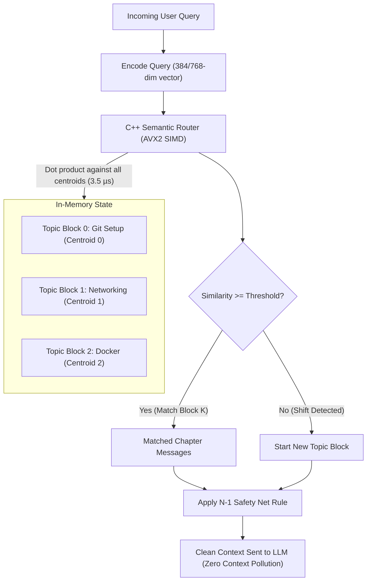

# Semantic Clustering Router Integration for Uxie

## 1. Overview

Uxie's previous conversational pivot detection relied on an external cloud call to **Groq (`llama-3.3-70b-versatile`)**. Every user query sent recent chat history over the internet with an LLM prompt to classify whether a topic change occurred.

### Pain Points of the Old Approach:
1. **High Latency**: Added 300ms–800ms to every interaction.
2. **Fragility & Cost**: Depended on remote API availability and model retention (which recently failed with HTTP 404 when models were deprecated).
3. **Destructive History Truncation**: When Groq detected a "pivot", Uxie set a single `pivot_index` cut-point, permanently erasing access to earlier conversation turns. Returning to an earlier topic lost all historical context.

---

## 2. The New Architecture: C++ AVX2 Semantic Router

The C++ Semantic Clustering Router (`semantic_router_cpp`) replaces cloud-based detection with an **in-process, AVX2 SIMD-vectorized topic clustering engine**.



### Key Technical Properties:
* **Microsecond Execution**: Scans all topic centroids using AVX2 SIMD fused multiply-add (`_mm256_fmadd_ps`), completing routing in **~30 microseconds** (a ~10,000x speedup).
* **Contiguous Cache Alignment**: Topic centroids are stored in an `AlignedMatrix` on 64-byte boundaries for streaming memory access.
* **Non-Destructive Chapters**: Conversations are grouped into distinct **Topic Blocks**. When a user discusses Topic A, shifts to Topic B, and then returns to Topic A, the system dynamically retrieves Topic A's chapter.
* **N-1 Safety Net Rule**: The immediately preceding assistant turn is always included in the prompt payload, ensuring that brief conversational follow-ups (e.g. *"Why is that?", "Give me an example"*) never break even if the mathematical similarity shifts.
* **Zero-Latency Local Web Search Classifier**: Replaced Groq's web search prompt with a sub-millisecond local classifier (`should_web_search`).

---

## 3. Configuration (`config/settings.yaml`)

```yaml
# --- Semantic Clustering Router (C++ AVX2 SIMD) ---
semantic_router:
  threshold: 0.55    # Minimum cosine similarity to match an existing topic block (0.0 - 1.0)
  dimension: 768     # Matches all-mpnet-base-v2 (use 384 for MiniLM)
```

---

## 4. Verification & Testing

### Run Full Test Suite (12 tests):
```powershell
d:\PROJECTS\python_envs\dev_env\Scripts\python.exe -m pytest D:\PROJECTS\projects_py\uxie\tests
```

### Run Multi-Turn E2E Simulation:
```powershell
d:\PROJECTS\python_envs\dev_env\Scripts\python.exe D:\PROJECTS\projects_py\uxie\demo_semantic_router_e2e.py
```
